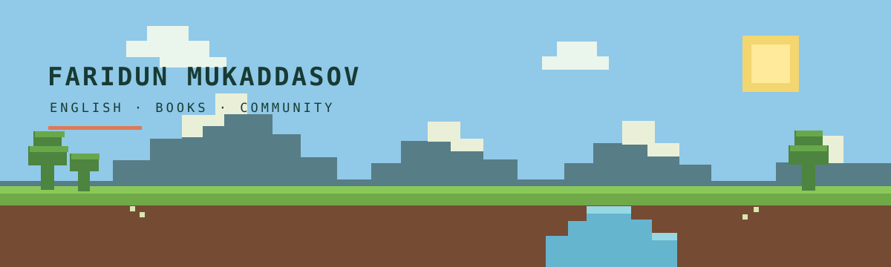

  
    
  <samp>ONE BLOCK AT A TIME · ONE NEW POSSIBILITY AT A TIME</samp>

<h1 align="center">Hey, I'm Faridun 👋</h1>

<strong>Writer · Community project creator · English learning advocate</strong>

I write books and create community projects that help young people learn English and build their careers through language.

  <a href="https://fmmadski.github.io/PersonalMadsCode/"><strong>🧭 Explore Meridian</strong></a>
  &nbsp; · &nbsp;
  <a href="https://github.com/fmmadski/PersonalMadsCode"><strong>📦 Visit the project repo</strong></a>

---

### 🌱 Current quest: Meridian

Meridian is a creative learning community for beginners. Through books and community projects, it helps young people grow their English and discover new possibilities for their futures.

| 🧱 Learn | 📚 Read | 🌍 Build together |
|:--|:--|:--|
| Grow English from the ground up | Make language welcoming through books | Turn practice into shared projects |

### 🪓 What I build

- **Books** that make learning English feel approachable for beginners.
- **Community projects** that help young people connect language learning with career growth.
- **New possibilities** — made together, one small step at a time.

   
  Thanks for stopping by my little corner of the Overworld ✨

